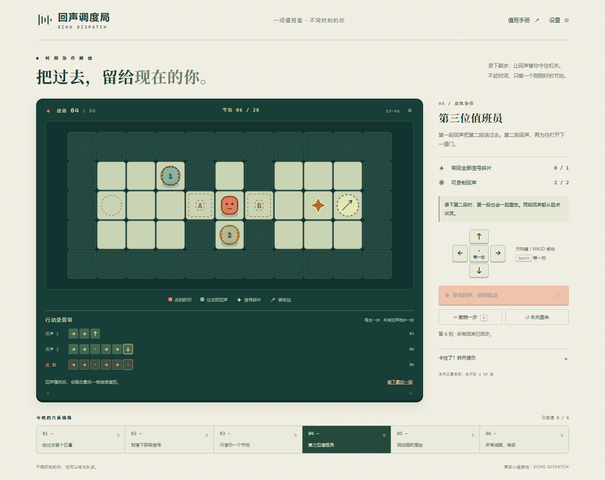

---
domain:
  - games
tags:
  - puzzle
  - time-loop
  - browser-game
language:
  - zh
license: MIT
deployspec:
  entry_file: index.html
---

# 回声调度局 · Echo Dispatch

**把过去，留给现在的你。**

一款回合制时间协作解谜游戏。录下一段行动，倒带后让回声重复它；让过去的你踩住机关，帮助现在的你收集信号、穿过闸门，抵达接收站。

Six short puzzles about cooperating with recordings of your past self. Every deliberate move advances every actor by one beat. No timer, account, paid API, or runtime model is required.



[观看 57 秒实录演示（MP4）](media/demo.mp4)：依次演示第一次录音、短暂开门窗口和双回声接力；全部通过真实键盘与按钮操作完成。

## 开始游戏

安装 Node.js 22 或更高版本，在项目目录运行：

```sh
npm start
```

打开 <http://127.0.0.1:7860>。无需 `npm install`，没有运行时依赖。终端按 Ctrl+C 停止服务。

| 操作 | 键盘 | 触屏 / 鼠标 |
| --- | --- | --- |
| 移动 | 方向键或 WASD | 方向按键 |
| 等待一拍 | Space 或 `.` | 中央「等一拍」 |
| 录制并倒带 | R | 「录成回声，回到起点」 |
| 所有人退回上一拍 | Z | 「撤销一步」 |
| 撤下最后一段录音 | — | 录音带下方按钮 |
| 重新安排本关 | — | 「本关重来」，再确认 |

先到 A 开关上录成回声。倒带后等它站上开关，下一拍就能穿过 A 门。第一关的可展开提示给出了完整操作序列。

## 玩法与关卡

- 六个原创关卡，逐步引入信号收集、短暂开门窗口、双轨协作与三个开关的接力。
- 回声记录的是方向和等待指令，仍受墙与门约束；录音结束后停在最后一格。
- 所有行动使用同一份「本拍开始时的开关状态」，角色处理顺序不影响结果。站上开关后下一拍可以穿门；离开开关的那一拍仍按原状态行动。
- 任何角色都能压住开关，也能与其他角色站在同一格。只有当前玩家能收集信号。
- 撞墙也前进一拍。撤销同步恢复所有角色、机关和信号，支持在通关后退回一步。
- 倒带会重置信号和角色，保留录音。录音长度上限和可用轨道在界面明确显示。
- 三星目标计算所有已保留录音长度加最终路线长度；重试和撤下的录音不计分。三星阈值是设计目标，不宣称全局最优解。
- 通关最佳成绩只保存在本机浏览器。音效默认关闭；减少动态效果可在设置中开启，也遵从系统偏好。
- 手机上操作区固定在底部，避免边操作边来回滚动找地图。切换关卡时回到地图。

## 构建与部署

```sh
npm run build
```

`dist/` 是七个静态网页文件，可以放在普通静态服务器或魔搭 Static 创空间。所有资源使用相对路径，不依赖外部 CDN、字体、图片或模型服务。不要直接用 `file://` 打开 ES Modules；请通过 HTTP 服务访问。

魔搭推荐使用 **Static**，入口为 `index.html`。仓库中的 YAML 元数据符合 [Studio Card 文档](https://www.modelscope.cn/docs/studios/studio-card)。创建时选择免费资源，将网页文件和此 README 上传到创空间，再按 [官方创建指南](https://www.modelscope.cn/docs/studios/create) 发布。平台账号登录、创建与上线需单独完成；本仓库不包含已上线的魔搭地址。

也提供可选 Docker 配置：

```sh
docker build -t echo-dispatch .
docker run --rm -p 7860:7860 echo-dispatch
```

容器以非 root 用户运行，监听 7860；不需要 GPU 或持久化服务。Docker 配置尚未做容器实机验证，Static 是本作的首选部署方式。

## 验证与实现

```sh
npm test
npm run build
```

22 项 Node 测试覆盖六关可解性、单角色无法绕过机关、同步门判定、回声受阻、收集与倒带、胜利撤销、容量边界、非法输入、存档损坏和静态服务资源边界。另有确定性的随机动作检查，验证每一步的地图边界、不变性及完整重放一致性。

本地浏览器回归使用独立的 Playwright CLI 会话：

```sh
npx --yes --package @playwright/cli playwright-cli -s=echo-dispatch open http://127.0.0.1:7860
npx --yes --package @playwright/cli playwright-cli -s=echo-dispatch run-code --filename=scripts/browser-smoke.js
npx --yes --package @playwright/cli playwright-cli -s=echo-dispatch close
```

该脚本会清除**测试浏览器**里的本游戏成绩并完成六关；不要在日常登录浏览器中执行。回归包括键盘完整通关、胜利撤销、刷新后成绩保留、对话框输入隔离、录音容量、重来、390px 触屏控制和减少动态效果。实际手机与 Safari 尚未验证。

| 文件 | 用途 |
| --- | --- |
| `src/engine.js` | 与界面无关的确定性状态转换 |
| `src/levels.js` | 地图、教学文本、三星目标与解法见证 |
| `src/app.js` | SVG 地图、录音轨、键鼠/触屏控制及可选合成音效 |
| `src/progress.js` | 容错的本机成绩存取 |
| `server.mjs` | 仅公开网页资源的最小本地静态服务 |

## AI 使用与素材来源

本项目采用 Codex 辅助设计与编程，包括玩法规则、六关地图、SVG/CSS 视觉、说明文字、测试和部署配置。代码不是手工独立完成的；浏览器验证使用 Playwright。游戏运行时的回声是确定性录音重放，不是 LLM NPC，也不宣称 AI 原生玩法。

视觉使用本项目编写的 SVG 和 CSS，声音由 Web Audio 合成；字体来自访问者设备的系统字体栈。未使用外部角色、图片、音乐或第三方游戏源码。项目以 MIT 许可证发布。

游戏本身没有遥测、网络模型请求、账户或排行榜。成绩数据仅在浏览器 `localStorage` 中；清除站点数据即可删除。静态托管平台可能有自己的访问日志，具体以平台政策为准。
